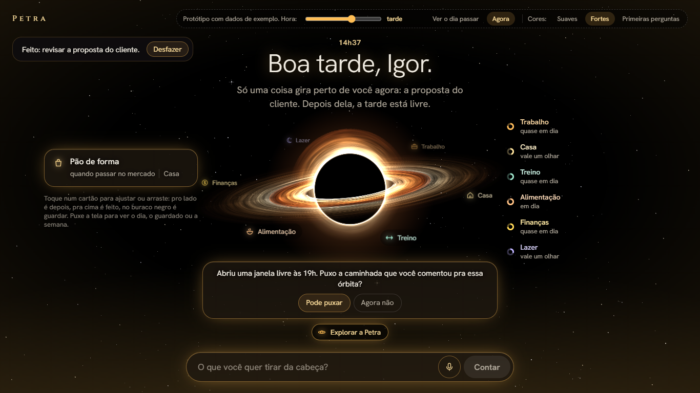
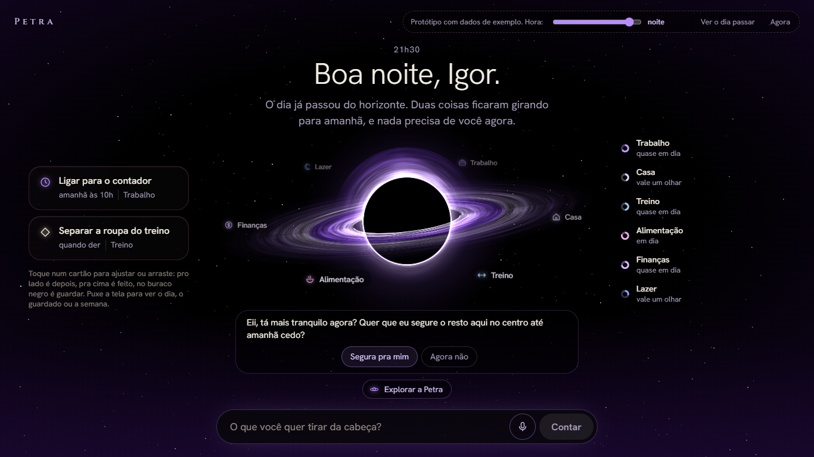
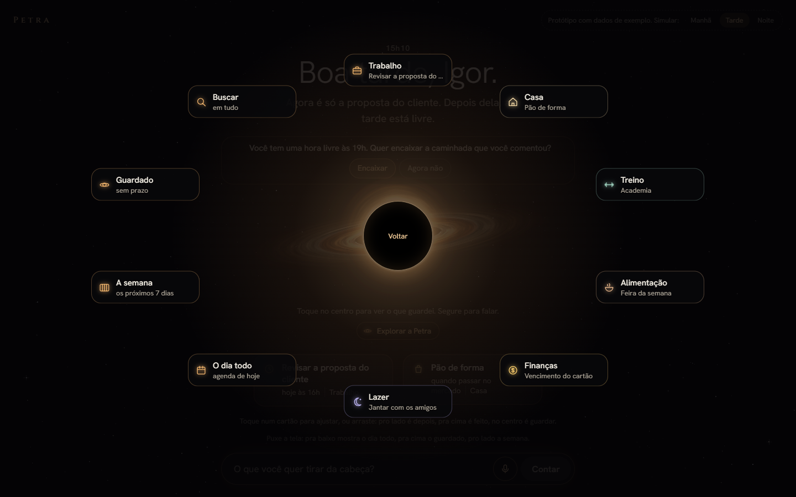
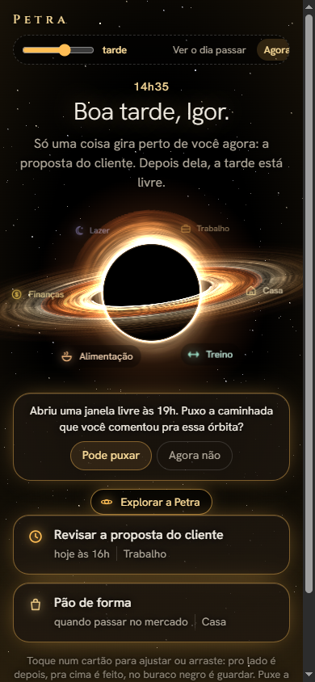

# P E T R A

**Você conta o que está na cabeça. A Petra organiza e mostra o que importa agora.**

Um organizador de vida pessoal (trabalho, casa, treino, alimentação, finanças e lazer) com cara de universo, e não de planilha.

> Projeto pessoal em desenvolvimento por [Igor Kayan](https://github.com/igorkayan). O código está num repositório privado; este repositório apresenta o que a Petra já faz e para onde ela vai.

---

## A ideia

A maioria dos apps de organização pede que você vire secretário da própria vida: cadastrar, categorizar, arrastar, conferir. A Petra inverte isso. Você fala ou escreve do jeito que fala com alguém ("dentista quinta às 15h", "comprar pão quando passar no mercado", "queria voltar a caminhar") e ela entende, guarda no lugar certo e devolve só o que importa naquele momento.

No centro da tela há um buraco negro. As áreas da sua vida giram em órbita ao redor dele, e as cores do céu mudam com a hora do dia, da madrugada ao pôr do sol.

| À noite | Explorar | No celular |
| :---: | :---: | :---: |
|  |  |  |

Imagens com dados de exemplo.

---

## O que já existe

### Uma tela só
- **Entrada única** por texto ou voz: "O que você quer tirar da cabeça?"
- **Entende frases em português** e separa sozinha compromisso, tarefa, compra, hábito, ideia, intenção e memória. Pergunta só o indispensável e mostra uma confirmação curta e editável.
- **Gestos**: arrastar pro lado é "depois", pra cima é "feito", e no buraco negro é "guardar". Tudo tem Desfazer.
- **Explorar a Petra**: o dia todo, a semana, o que está guardado, a busca e uma página para cada área.
- **Cores pela hora do dia**, em versão suave ou forte.
- **Primeiras perguntas** (nome, horários, áreas e avisos) para a Petra já começar do seu jeito.

### Uma companheira, não um formulário
- **Personalidade própria**: ela cumprimenta de manhã, entende "agora não" e volta na hora combinada. Se você recusar de novo, ela não insiste.
- **Resumo do dia em voz alta**, com as vozes do próprio computador.
- **Memória da vida**: "guarda que a senha do wi-fi da casa da minha mãe é..." e depois "qual era a senha do wi-fi?".
- **Perguntas** sobre o que está guardado: "o que tenho amanhã?", "quando foi a última vez que fui ao dentista?", "quanto gastei com mercado em outubro?".
- **Print, foto ou câmera**: a Petra lê o texto da imagem (OCR) no próprio computador e transforma em itens.

### O ciclo do dia
- **Manhã que monta o dia**: compromissos, até 3 prioridades sugeridas, as tarefas encaixadas nas janelas livres e quanto dá para gastar hoje. Um toque em "Bora" aplica tudo.
- **Fechamento da noite**: ela celebra o que foi feito, passa pelas pendências uma a uma (amanhã, outro dia, pausar ou não preciso mais), marca os hábitos e deixa o amanhã pronto.
- **Dia corrido**: quando o dia desanda, ela mantém o essencial e remaneja o resto, mostrando antes e depois.
- **Sugerir a semana**: encaixa tarefas nos espaços livres respeitando sono, descanso e lazer, e explica o porquê de cada escolha.

### As áreas da vida
- **Trabalho**: projetos com a próxima ação, ideias, pausadas e expediente.
- **Casa**: tarefas por ambiente, frequências e divisão entre as pessoas da casa.
- **Treino e hábitos**: dias de academia com trajeto e banho reservados, e evolução sem culpa.
- **Alimentação**: plano semanal de refeições e lista de compras gerada a partir dele.
- **Lazer**: atividades que você quer fazer e horários protegidos de descanso.

### Dinheiro que conversa com a rotina
- **Quanto pode gastar hoje**, quanto fica livre até o próximo pagamento e quanto você precisa para viver.
- **Cartões**: fatura por fechamento, parcelas futuras e importação da fatura em CSV.
- **Dono de cada gasto**, para quando outras pessoas usam o seu cartão, com a mensagem de cobrança pronta.
- **Dívidas** com plano de quitação, **envelopes** em % da renda, **metas**, **"Posso comprar?"** e **projeção de 6 meses**.
- Conexão com bancos pelo Open Finance (Meu Pluggy) e importação de extrato OFX.

### Feito para durar
- Roda **no seu computador**, com os dados num banco SQLite local. Nada sai sem você ligar e saber.
- Backup e restauração, lixeira, exportação em CSV e migrações que nunca apagam dados.
- Versão desktop instalável para Windows.

---

## O que vem por aí

| Próximo | O que muda |
| --- | --- |
| **Objetivos, anéis e sequências** *(em andamento)* | Você define de 3 a 5 objetivos. A Petra mede sozinha a meta da semana, os anéis de cada área passam a mostrar o seu progresso, e ainda tem sequências, recordes, dia de folga e celebração. |
| **Petra proativa** | Uma sugestão por vez, aceita com um toque: "5 dias sem treinar, encaixo amanhã às 7h?", "faz 3 semanas sem lazer e sábado está livre". |
| **Domingo como história** | A semana contada em poucas linhas, com o mês comparado ao anterior. |
| **Personagem da Petra** | Uma persona visual com estados (ouvindo, pensando, falando). |
| **No celular** | App instalável e avisos de verdade, mesmo longe do computador. |
| **Conversa com IA** | Entender qualquer frase, responder "como foi meu mês?" e planejar junto. |
| **Para todo mundo** | Login, nuvem, consentimento por tipo de dado, Alexa e alarmes, para virar produto para qualquer pessoa. |

---

## Por dentro

- **Interface**: React + TypeScript (Vite), com o buraco negro animado na própria página.
- **Servidor**: Node.js + TypeScript com Hono, ouvindo só no próprio computador.
- **Dados**: SQLite com migrações versionadas e cópia automática antes de cada uma. Dinheiro sempre em centavos.
- **Voz e OCR**: Web Speech API e Tesseract, rodando no navegador.
- **Desktop**: Electron.
- **Testes**: o test runner nativo do Node no servidor e Playwright no navegador.

Petra é um nome provisório.

